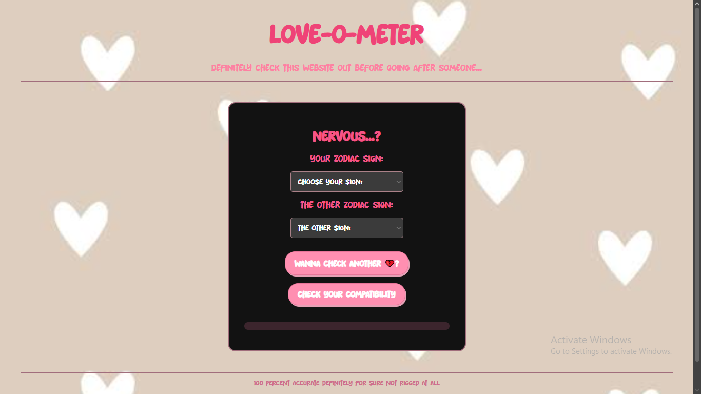

## love-o-meter

Demo:  https://lwhsbg.github.io/love-o-meter/

# What It Is

It is a compatibility percentage checker if you want to check your luck with another person. Just put yall's zodiac sign, and boot up the calculate button and boom, you get your results with a very specuial message written by me.

# How To Run It

It is very simple, the toughest part is not even in the website, which is figuring out the other person's zodiac symbol, and put it in the boxes, then just press the "Check your compatibility" box and then you will get your results. If you wanna check it maybe with another person, just click the "Wanna check another?" button and then just do the previous steps.

Only one zodiac pairing can achieve a 100 percent. Find out if you can :)))

# Why I Made It

I learned about javascript in school so I had some knowledge of it and wanted to try something new as all of my projects were just RenPy, and I suddenly had this memory of playing a love calculator game in school back when I was young, and decided to make a simple one.

# Tech Stack

-HTML

-CSS

-Javascript

# What I struggled with and what I learned

Javascript is a very hard language so that part was the one I struggled the most with, and I learned a lot of things about it while working on this project, and on HTML CSS part too such as this was the first project where I downloaded and learned to put up a font, and also making special and interactive buttons in the calculate part. It was really fun.

# Snapshot

